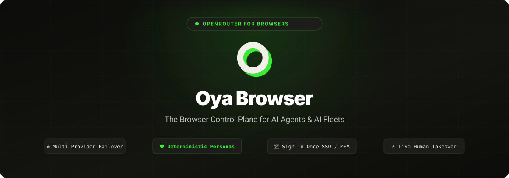

<p align="center">
  
</p>

<h3 align="center">Your agent does it once. After that, it's a script.</h3>

<p align="center">
  Oya is a real browser for AI agents. Save any run that worked, and it replays with
  no model, no tokens and no luck. When a page changes, the agent fixes that one step.
</p>

<p align="center">
  <a href="https://github.com/OyadotAI/oya-browser/releases/latest"></a>
  <a href="https://www.npmjs.com/package/@oya-ai/browser"></a>
  <a href="https://codecov.io/gh/OyadotAI/oya-browser"></a>
  <a href="LICENSE.md"></a>
  <a href="https://discord.gg/wqSeXJPygn"></a>
</p>

```js
import { Oya } from '@oya-ai/browser';

const browser = await new Oya().browser.start();
await browser.goto('https://httpbin.org/forms/post');

// Run 1: the agent works it out, and Oya records what it did.
let t = Date.now();
await browser.ask('Order a large pizza for {{name}}, then submit the order', { data: { name: 'Ada' } });
await browser.toPlaybook('pizza');
console.log(`agent:  ${(Date.now() - t) / 1000}s`);

// Every run after: the recorded steps with new inputs. No LLM in the loop.
t = Date.now();
await browser.play('pizza', { name: 'Alan' });
console.log(`replay: ${(Date.now() - t) / 1000}s, no model`);
await browser.stop();
```

That is the whole idea. [Run it in a minute](#quickstart).

## Why

Browser agents work in the demo and fall over in production:

| The problem | What Oya does |
|:---|:---|
| **Every run re-prompts the model.** Slow, costs tokens, and does something slightly different each time. | **Record once, replay forever.** A successful `ask()` becomes a playbook: deterministic steps, plus the same flow as a Playwright file you can read. [9 of 10 real sites replayed every step with no model and healing off.](docs/replay-benchmark.md) |
| **Real sites block bots.** Headless Chrome gets flagged on sight. | **A real browser with a stable identity.** Personas pin fingerprint, cookies and proxy across runs. [0% headless on CreepJS, 31/31 on Sannysoft.](docs/stealth.md) |
| **Logins, MFA and CAPTCHAs stop the run.** | **Built in.** Sealed passwords and TOTP the agent never sees, CAPTCHA solving, and your own signed-in desktop browser. [Logins](docs/logins.md) |
| **When the agent gets stuck, nobody can step in.** | **A person one click away.** Watch any run live, take over, hand it back. |
| **You are locked to one browser vendor.** | **One API, any backend.** Your Docker, Oya Cloud, Browserbase, Steel, Anchor, Browser Use, or any Chrome. [Why route through Oya?](docs/why-oya.md) |

<p align="center">
  
</p>
<p align="center"><sub>An agent run in the Oya desktop app, sped up. The portal and patient data are fictional.</sub></p>

## Quickstart

Runs everything on your machine: the control plane and a browser, in Docker. You need
[Docker](https://docs.docker.com/get-docker/) running and Node.js 20 or newer.

**1. Start Oya.** Export a model key first so the agent can think. Any one of these works:

```bash
export ANTHROPIC_API_KEY=sk-ant-...   # or OPENAI_API_KEY, or GEMINI_API_KEY
curl -fsSL https://raw.githubusercontent.com/OyadotAI/oya-browser/main/install.sh | sh -s -- --yes
```

The install takes about a minute, then prints two lines. Export them:

```bash
export OYA_BASE_URL=http://localhost:3100
export OYA_API_KEY=oya_...
```

No key yet? A [Gemini key](https://aistudio.google.com/apikey) is free. Expect a slow agent: on
Gemini 3.8 Flash the agent's run in the example at the top took 153s (one measured run). The
replay took 14s either way, because it calls no model.

**2. Install the SDK:**

```bash
npm install @oya-ai/browser
```

**3. Run your first agent.** Save as `agent.mjs` and run `node agent.mjs`:

```js
import { Oya } from '@oya-ai/browser';

const browser = await new Oya().browser.start();
await browser.goto('https://news.ycombinator.com');
console.log(await browser.ask('What are the top 3 stories and their points?'));
await browser.stop();
```

`start()` hands you the browser running in Docker. Open http://localhost:3100 with the same
key to watch it work.

**Then try the examples.** The installer cloned the repo to `~/oya-browser`:

```bash
cd ~/oya-browser/examples && npm install
cp .env.example .env   # paste the same OYA_BASE_URL and OYA_API_KEY
npx tsx --env-file=.env playwright/01-connect.ts
```

**Rather not run anything?** Get a key at [oyabrowser.com](https://oyabrowser.com), skip step 1,
and export only `OYA_API_KEY`: the same script runs on an Oya Cloud browser, or on the
[Oya desktop app](https://oyabrowser.com/#download) when it is open.

## Pick your model

Pass it in code. It applies to this client only and is never saved to your key:

```js
const oya = new Oya({
  model: { provider: 'anthropic', name: 'claude-sonnet-5', apiKey: process.env.ANTHROPIC_API_KEY },
});
```

`provider` is one of `openai`, `anthropic`, `gemini`, `vertex` or `openrouter`. With your own
`apiKey`, calls go straight to that provider and are billed to you.

## Use it from your coding agent

Install the [desktop app](https://oyabrowser.com/#download), sign in, and connect Claude Code,
Codex, Cursor or VS Code from the app. Your agent works in your own signed-in browser, in tabs of
its own, and you can take over at any moment.

Or connect any MCP client to Oya Cloud. For Claude Code:

```bash
claude mcp add --transport http oya https://oyabrowser.com/mcp/pool \
  --header "Authorization: Bearer $OYA_API_KEY"
```

Agents setting themselves up should read [oyabrowser.com/llms.txt](https://oyabrowser.com/llms.txt).

## Bring your own Playwright

Every Oya browser speaks CDP, so Playwright, Puppeteer, Stagehand and browser-use connect as they are:

```js
import { chromium } from 'playwright-core';
import { Oya } from '@oya-ai/browser';

const browser = await new Oya().browser.start();
const cdp = await chromium.connectOverCDP(browser.cdpUrl);
const context = cdp.contexts()[0];
const page = context.pages()[0] ?? (await context.newPage());
await page.goto('https://example.com');
console.log(await page.title());
await cdp.close();
await browser.stop();
```

## Examples

| Example | What it shows | Runs on |
| :--- | :--- | :--- |
| [`sdk/01-quickstart.ts`](examples/sdk/01-quickstart.ts) | Start a browser and drive it in plain English | Local install or Oya Cloud |
| [`sdk/05-playbooks.ts`](examples/sdk/05-playbooks.ts) | Record, replay, background runs and auto-heal | Local install or Oya Cloud |
| [`playwright/01-connect.ts`](examples/playwright/01-connect.ts) | Standard Playwright through Oya's CDP endpoint | Local install or Oya Cloud |
| [`sdk/03-mfa.ts`](examples/sdk/03-mfa.ts) | Password plus TOTP sign-in the agent never sees | The desktop app (it pairs it) |
| [`sdk/02-captcha.ts`](examples/sdk/02-captcha.ts) | CAPTCHA detection and solving | Oya Cloud, or a solver key in Settings |
| [`sdk/04-personas.ts`](examples/sdk/04-personas.ts) | Stable device identities you reuse across runs | Oya Cloud |
| [`playwright/reddit/`](examples/playwright/reddit/) | 10 parallel browsers through a residential proxy | Oya Cloud, with a proxy on the persona |
| [`multi-vendor/`](examples/multi-vendor/01-multi-vendor.ts) | One script on Oya Cloud, Browserbase, Steel, Anchor and Browser Use | Oya Cloud plus each vendor's key |

The local install runs one Docker browser and no Oya Cloud. For the Oya Cloud rows, use a key from
[oyabrowser.com](https://oyabrowser.com) and leave `OYA_BASE_URL` unset.

All of them: [examples/](examples/README.md).

## In production

The quickstart's install runs SQLite and one browser. For more browsers, Postgres, and
deployments on Docker, Amazon ECS, Kubernetes or GKE, see the
[self-hosting guide](docs/self-hosting.md) and [deployment templates](deployments/).

## Governance

Self-hosted deployments include host egress rules and a tamper-evident audit trail.
[Control evidence](compliance/EVIDENCE.md) · [Trust center](https://oyabrowser.com/trust).
This repository is the community edition. The enterprise edition, including the HIPAA-ready
offering, is separate: [sales@getoya.ai](mailto:sales@getoya.ai).

## Contributing

```bash
git clone https://github.com/OyadotAI/oya-browser.git && cd oya-browser
npm run setup
```

Read [ARCHITECTURE.md](ARCHITECTURE.md) for the map and [AGENTS.md](AGENTS.md) for the
conventions and each part's commands. Issues and pull requests are welcome; so is
[Discord](https://discord.gg/wqSeXJPygn).

| Path | What it is |
| :--- | :--- |
| [`packages/sdk`](packages/sdk) | `@oya-ai/browser`, the TypeScript SDK (MIT) |
| [`packages/cli`](packages/cli) | `@oya-ai/cli`, setup and terminal commands (MIT) |
| [`browser`](browser) | The desktop browser and the cloud browser image |
| [`server`](server) | API, MCP, browser connections and control plane |
| [`ui`](ui) | Web console and public site |

## License

The SDK and CLI are MIT. Everything else is under the Sustainable Use License: see
[LICENSE.md](LICENSE.md) for self-hosting terms and commercial licensing.
