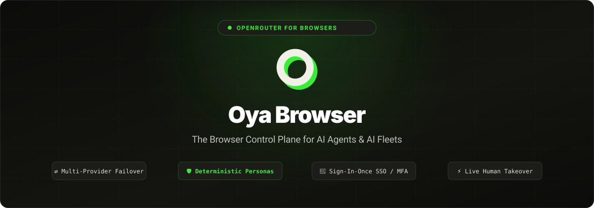

<p align="center">
  
</p>

<p align="center">
  <a href="https://github.com/OyadotAI/oya-browser/releases/latest"></a>
  <a href="https://www.npmjs.com/package/@oya-ai/browser"></a>
  <a href="https://pypi.org/project/oya-browser/"></a>
  <a href="https://codecov.io/gh/OyadotAI/oya-browser"></a>
  <a href="LICENSE.md"></a>
  <a href="https://discord.gg/wqSeXJPygn"></a>
  <a href="https://mcptry.com/servers/io.github.OyadotAI/oya-browser"></a>
</p>

<p align="center">
  <a href="https://www.producthunt.com/products/oya-browser?embed=true&amp;utm_source=badge-featured&amp;utm_medium=badge&amp;utm_campaign=badge-oya-browser" target="_blank" rel="noopener noreferrer"></a>
</p>

# Oya Browser

Oya Browser is a HIPAA-compliant browser for healthcare and regulated work: an AI browser on your
desktop, and an agentic browser your agents run in the cloud or self-hosted, with every action on a
tamper-evident audit trail. An agent completes a task once in natural language; Oya records the
steps as a playbook that replays deterministically, without calling a model, and repairs individual
steps when a page changes. People can watch any session and take control at any time.

This repository contains the community edition: the browser, the control plane, the web console,
the CLI, and the SDKs: [TypeScript on npm](https://www.npmjs.com/package/@oya-ai/browser)
(`npm install @oya-ai/browser`) and [Python on PyPI](https://pypi.org/project/oya-browser/)
(`pip install oya-browser`). HIPAA compliance and a signed BAA come with Oya Cloud and the
enterprise edition.

- [Features](#features)
- [Install for Claude Code or Codex](#install-for-claude-code-or-codex)
- [Requirements](#requirements)
- [Quickstart](#quickstart)
- [Usage](#usage)
- [Samples](#samples)
- [Deployment](#deployment)
- [Security and compliance](#security-and-compliance)
- [Documentation](#documentation)
- [Support](#support)
- [Contributing](#contributing)
- [License](#license)

## Features

- **Record and replay.** A successful `ask()` is saved with `toPlaybook()` and replayed with
  `play()` using new inputs and no model calls. Each playbook is also exported as a Playwright
  module. In a [ten-site benchmark](docs/replay-benchmark.md), nine sites replayed every recorded
  step with healing disabled.
- **Step repair.** When a recorded step no longer matches the page, the agent completes that step
  and the playbook is updated. Repair can be disabled per call.
- **Stable browser identity.** Personas bind a fingerprint, cookie store and proxy that persist
  across sessions ([stealth results](docs/stealth.md): 0% headless on CreepJS, 31/31 on
  Sannysoft).
- **Authentication.** Stored passwords and TOTP seeds are sealed and never exposed to the model.
  CAPTCHA detection and solving, and reuse of logins from your desktop browser, are built in
  ([logins](docs/logins.md)).
- **Human in the loop.** Any session can be watched live and taken over, then returned to the
  agent.
- **Provider choice.** The same API runs browsers on your own Docker hosts, Oya Cloud,
  Browserbase, Steel, Anchor, Browser Use or any Chrome endpoint ([comparison](docs/why-oya.md)).
- **Standard protocols.** Every browser exposes CDP for Playwright, Puppeteer and similar
  clients, and an MCP endpoint for AI assistants.

<p align="center">
  
</p>
<p align="center"><sub>An agent session in the Oya desktop app, accelerated. The portal and patient data are fictional.</sub></p>

## Install for Claude Code or Codex

**To use your desktop browser**, [download Oya Browser](https://oyabrowser.com/#download), open it, and finish the welcome screen. Click **Connect** next to **Claude Code** or **Codex**, confirm, and start a new agent session. Keep Oya open while you browse.

**To use Oya Cloud**, follow the steps for your agent below.

### Claude Code

Install the Oya Cloud plugin from your terminal:

```bash
claude plugin marketplace add OyadotAI/oya-browser
claude plugin install oya-browser@oya
```

Start a new Claude Code session, run `/mcp`, select the Oya server, and follow the sign-in prompt.

### Codex

Create an API key in the [Oya dashboard](https://oyabrowser.com/dashboard). Set `OYA_API_KEY` in the environment where you run Codex, then register the cloud server once:

```bash
codex mcp add oya-cloud --url https://oyabrowser.com/mcp/pool --bearer-token-env-var OYA_API_KEY
```

Start a new Codex session with that environment variable set. To verify either installation, ask your agent to open `https://example.com` with Oya and report the page title.

## Requirements

| Component | Version |
| :--- | :--- |
| Node.js | 20 or later |
| Docker | Docker Desktop or Docker Engine with buildx for all deployment examples; Compose 2.24 or later for Docker deployments |
| Deployment tools | `kubectl` + `python3` for Kubernetes; AWS CLI v2 for ECS; `gcloud`, `kubectl`, `python3` and `gke-gcloud-auth-plugin` for GKE |
| Model API key | Anthropic, OpenAI or Gemini, for natural-language tasks |

## Quickstart

This quickstart installs the control plane and one browser on your machine with Docker, then runs
a sample that records a task and replays it.

### 1. Install the control plane

Export a model API key, then run the installer:

```bash
export ANTHROPIC_API_KEY=sk-ant-...   # or OPENAI_API_KEY, or GEMINI_API_KEY
curl -fsSL https://raw.githubusercontent.com/OyadotAI/oya-browser/main/install.sh | sh -s -- --yes
```

The installer clones this repository to `~/oya-browser`, starts the services and prints the
connection settings. Export them:

```bash
export OYA_BASE_URL=http://localhost:3100
export OYA_API_KEY=oya_...
```

### 2. Install the SDK

```bash
npm install @oya-ai/browser   # TypeScript: https://www.npmjs.com/package/@oya-ai/browser
pip install oya-browser       # or Python: https://pypi.org/project/oya-browser/
```

### 3. Run the sample

Save the following as `agent.mjs` and run `node agent.mjs`:

```js
import { Oya } from '@oya-ai/browser';

const browser = await new Oya().browser.start();
await browser.goto('https://httpbin.org/forms/post');

// Run 1: the agent works it out, and Oya records what it did.
let t = Date.now();
await browser.ask('Order a large pizza for {{name}}, then submit the order', { data: { name: 'Ada' } });
await browser.toPlaybook('pizza');
console.log(`agent:  ${(Date.now() - t) / 1000}s`);

// Every run after: the recorded steps with new inputs. No LLM in the loop.
t = Date.now();
await browser.play('pizza', { name: 'Alan' });
console.log(`replay: ${(Date.now() - t) / 1000}s, no model`);
await browser.stop();
```

The agent completes the order once and the result is saved as the playbook `pizza`. The replay
submits the same order for a different name without calling the model. Output from one run with
Gemini 3.8 Flash:

```text
agent:  152.712s
replay: 14.246s, no model
```

Agent time depends on the model; replay time does not. To watch the session, open
http://localhost:3100 and sign in with the same API key.

### Using Oya Cloud instead

To skip the local installation, create an API key at [oyabrowser.com](https://oyabrowser.com),
export only `OYA_API_KEY`, and run the same sample. `start()` uses the
[Oya desktop app](https://oyabrowser.com/#download) when it is open and signed in, and otherwise
starts a browser in Oya Cloud.

## Usage

### Choosing a model

By default, `ask()` uses the model configured for your API key. To choose one in code, pass
`model` to the client. The setting applies to that client only and is not saved:

```js
const oya = new Oya({
  model: { provider: 'anthropic', name: 'claude-sonnet-5', apiKey: process.env.ANTHROPIC_API_KEY },
});
```

Supported providers are `openai`, `anthropic`, `gemini`, `vertex` and `openrouter`. When
`apiKey` is set, requests go directly to that provider and are billed to your account.

### Connecting Playwright and other CDP clients

Every Oya browser exposes a CDP endpoint, so Playwright, Puppeteer, Stagehand and browser-use
connect without changes:

```js
import { chromium } from 'playwright-core';
import { Oya } from '@oya-ai/browser';

const browser = await new Oya().browser.start();
const cdp = await chromium.connectOverCDP(browser.cdpUrl);
const context = cdp.contexts()[0];
const page = context.pages()[0] ?? (await context.newPage());
await page.goto('https://example.com');
console.log(await page.title());
await cdp.close();
await browser.stop();
```

### Connecting AI assistants

Install and open the [desktop app](https://oyabrowser.com/#download), complete
its welcome screen and click Connect next to your installed agent (Claude Code,
Codex, Cursor or VS Code). Confirm the connection, then start a new agent
session. Oya writes the local configuration for an MCP server named `oya-browser` at
`http://127.0.0.1:47321/mcp` to the agent's config; no account, no key. The agent
then uses Oya as its browser in place of Chrome: each session gets its own tab,
you keep yours, and you can take control at any time.

Keep Oya open for repeat use. If the tools are missing, open Oya, check Connect
and start a new agent session. If it says "Browser not ready", complete the
welcome screen and retry. Login import is optional and may require OS permission;
you can sign in within Oya instead. The app includes its MCP server, so no separate
extension or MCP package is required. See [Oya for coding agents](https://oyabrowser.com/browser-for-claude-code).

With no desktop (servers, containers, CI), any MCP client can use Oya Cloud. For
Claude Code:

```bash
claude mcp add --transport http oya https://oyabrowser.com/mcp/pool \
  --header "Authorization: Bearer $OYA_API_KEY"
```

The optional Claude Code plugin connects to **Oya Cloud**, signs in with your Oya account
(no key to set), and includes a browsing skill. For desktop browsing, use Connect instead.

Setup instructions written for agents are published at
[oyabrowser.com/llms.txt](https://oyabrowser.com/llms.txt).

## Samples

The [`examples`](examples/README.md) directory contains runnable TypeScript samples. After the
quickstart, the installer's copy is ready to use:

```bash
cd ~/oya-browser/examples && npm install
cp .env.example .env   # set OYA_BASE_URL and OYA_API_KEY
npx tsx --env-file=.env playwright/01-connect.ts
```

| Sample | Description | Runs on |
| :--- | :--- | :--- |
| [`sdk/01-quickstart.ts`](examples/sdk/01-quickstart.ts) | Start a browser and complete a task in natural language | Local installation or Oya Cloud |
| [`sdk/05-playbooks.ts`](examples/sdk/05-playbooks.ts) | Record, replay, background runs and step repair | Local installation or Oya Cloud |
| [`playwright/01-connect.ts`](examples/playwright/01-connect.ts) | Playwright through the CDP endpoint | Local installation or Oya Cloud |
| [`sdk/03-mfa.ts`](examples/sdk/03-mfa.ts) | Password and TOTP sign-in with sealed credentials | Desktop app |
| [`sdk/02-captcha.ts`](examples/sdk/02-captcha.ts) | CAPTCHA detection and solving | Oya Cloud, or a configured solver |
| [`sdk/04-personas.ts`](examples/sdk/04-personas.ts) | Persistent browser identities | Oya Cloud |
| [`playwright/reddit/`](examples/playwright/reddit/) | Ten parallel browsers through a residential proxy | Oya Cloud, with a proxy assigned to the persona |
| [`multi-vendor/`](examples/multi-vendor/01-multi-vendor.ts) | One script across Oya Cloud, Browserbase, Steel, Anchor and Browser Use | Oya Cloud and each provider's API key |

The local installation runs one Docker browser. For samples that require Oya Cloud, use an API
key from [oyabrowser.com](https://oyabrowser.com) and leave `OYA_BASE_URL` unset.

## Deployment

The quickstart above uses `--yes` for SQLite and one Docker browser. For a guided deployment,
run the installer without `--yes`:

```bash
curl -fsSL https://raw.githubusercontent.com/OyadotAI/oya-browser/main/install.sh | sh
```

Choose **Docker**, **Kubernetes**, **Amazon ECS** or **Google Cloud / GKE**. The wizard uses the
existing [`deployments/`](deployments/README.md) examples to deploy the control plane, Postgres
and browser runtime together. Advanced settings cover image overrides, networking, replicas
and optional services. Each question explains the value, its format and default, and where to
find it with a lookup command or console path. Lookup commands are shown for you to run.
The flow moves through Target, Configure, Deploy and Verify, checks prerequisites, waits for
readiness, then verifies a browser session before reporting success.

From a checkout, run the current local wizard:

```bash
make wizard
make wizard ARGS="--target k8s"     # skip the destination menu
make wizard ARGS="--target docker --dry-run"   # preview without changing files or resources
```

Nonsecret answers are saved to `oya-install.json`; `oya install --config oya-install.json`
repeats that deployment without questions. Existing version 1 plans and bare `--yes` keep the
original quickstart behavior. Kubernetes and GKE smoke checks use a private port-forward;
public DNS and TLS may need additional setup. Cloud resources are billable.

See the [self-hosting guide](docs/self-hosting.md) for saved plans, credentials and recovery,
and the [deployment guides](deployments/README.md) for prerequisites, backups and removal.

## Security and compliance

Self-hosted deployments include host-level egress rules and a tamper-evident audit trail. See the
[control evidence](compliance/EVIDENCE.md) and the [trust center](https://oyabrowser.com/trust).
To report a vulnerability, follow [SECURITY.md](SECURITY.md).

An enterprise edition, including a HIPAA-ready offering, is maintained separately.
[Book a time with the founders](https://calendly.com/d/dvrm-r65-kkx/oya-founder-call).

## Documentation

| Topic | Link |
| :--- | :--- |
| SDK reference | [packages/sdk](packages/sdk/README.md) |
| CLI reference | [packages/cli](packages/cli/README.md) |
| Self-hosting | [docs/self-hosting.md](docs/self-hosting.md) |
| Logins and sessions | [docs/logins.md](docs/logins.md) |
| Replay benchmark | [docs/replay-benchmark.md](docs/replay-benchmark.md) |
| Architecture | [ARCHITECTURE.md](ARCHITECTURE.md) |

## Support

- Questions and discussion: [Discord](https://discord.gg/wqSeXJPygn)
- Bug reports and feature requests: [GitHub Issues](https://github.com/OyadotAI/oya-browser/issues)
- Self-hosted license (more than 5 cloud browsers): [oyabrowser.com/dashboard/billing](https://oyabrowser.com/dashboard/billing#self-hosted)
- Enterprise: [book a time with the founders](https://calendly.com/d/dvrm-r65-kkx/oya-founder-call)

## Contributing

Contributions are welcome. To set up a development environment:

```bash
git clone https://github.com/OyadotAI/oya-browser.git && cd oya-browser
npm run setup
```

Read [ARCHITECTURE.md](ARCHITECTURE.md) for an overview of the codebase and [AGENTS.md](AGENTS.md)
for conventions and the checks each part requires.

| Path | Contents |
| :--- | :--- |
| [`packages/sdk`](packages/sdk) | `@oya-ai/browser`, the TypeScript SDK (MIT) |
| [`packages/cli`](packages/cli) | `@oya-ai/cli`, installation and command-line tools (MIT) |
| [`browser`](browser) | The desktop browser and the cloud browser image |
| [`server`](server) | API, MCP, browser connections and control plane |
| [`ui`](ui) | Web console and public site |

## License

The SDK and CLI are licensed under MIT. All other components are available under the Sustainable
Use License. See [LICENSE.md](LICENSE.md) for permitted use, self-hosting terms and commercial
licensing.
